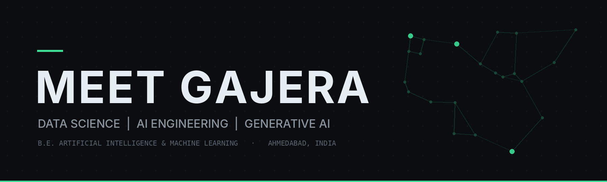
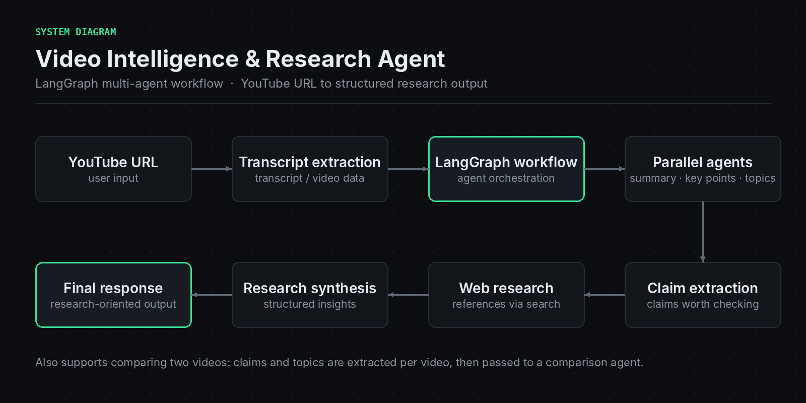
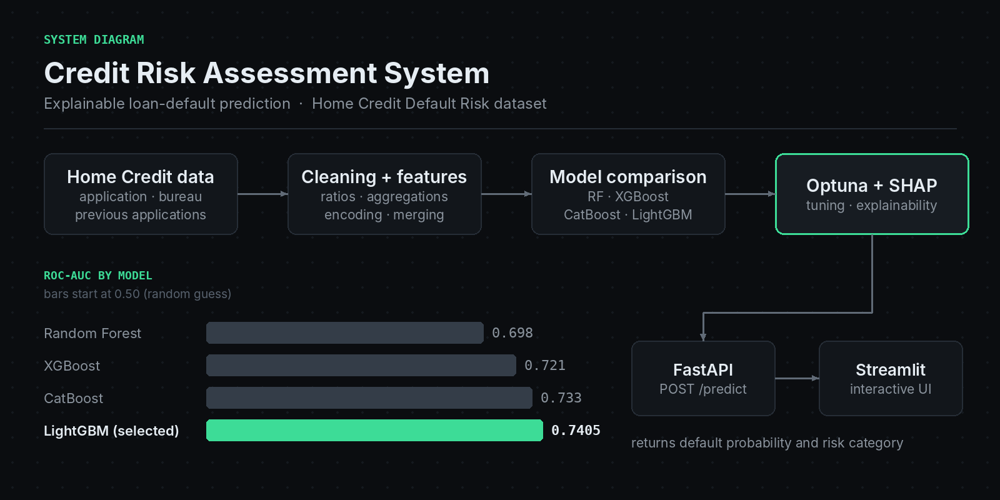
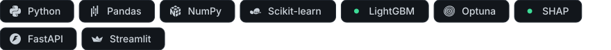
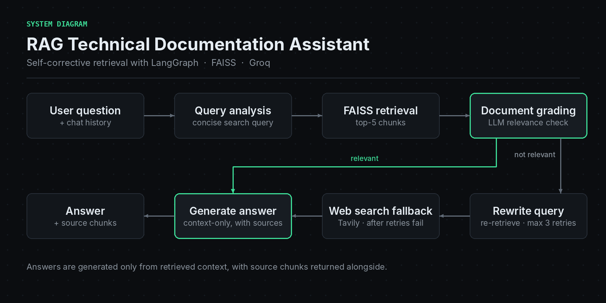
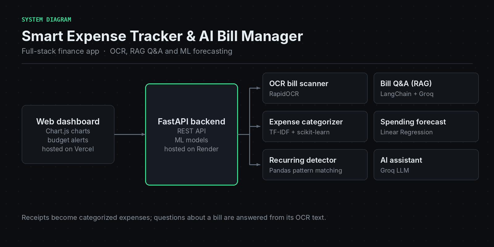
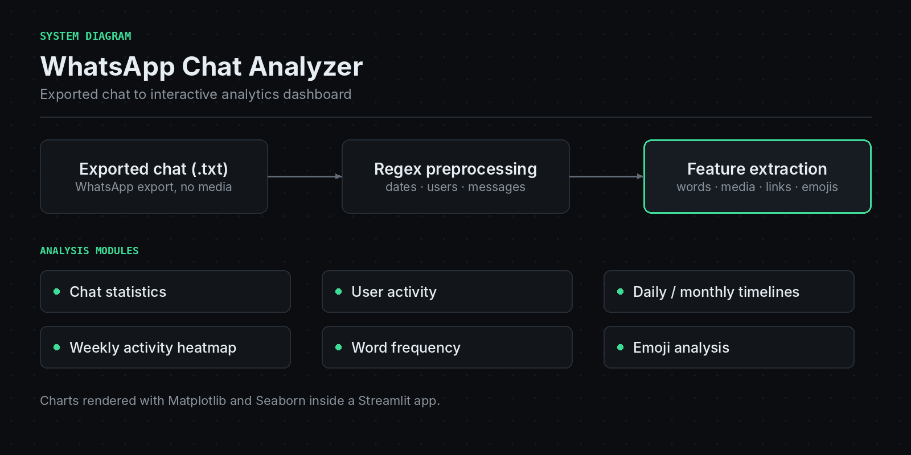
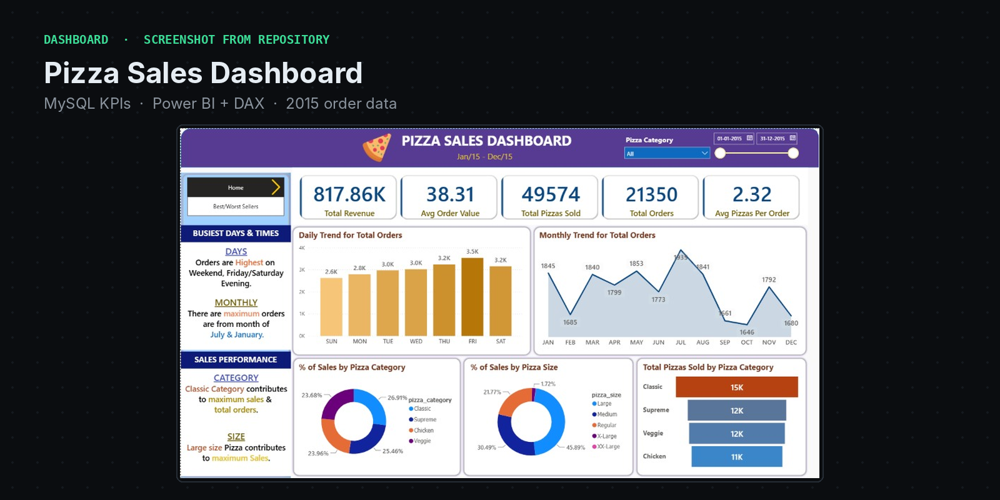
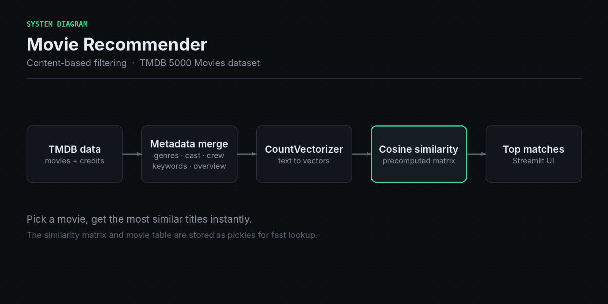
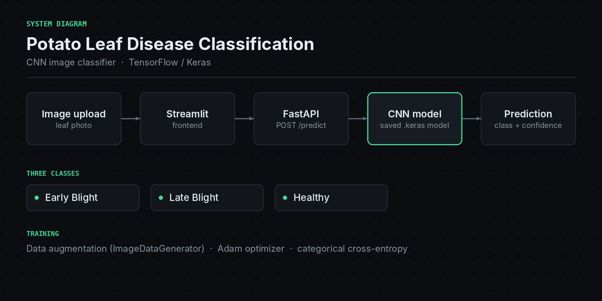

  
    
  <b>AI &amp; ML UNDERGRADUATE</b> 
  Data Science | Generative AI | Intelligent Systems
    
  I build practical machine learning and AI-powered applications, from explainable 
  credit-risk models to multi-agent LLM systems, and I'm interested in turning 
  technical ideas into useful products.
    
  Ahmedabad, Gujarat, India
    
  
  
  
  
    
  <a href="#about-me">About</a> &nbsp;·&nbsp; <a href="#featured-projects">Projects</a> &nbsp;·&nbsp; <a href="#technical-skills">Skills</a> &nbsp;·&nbsp; <a href="#lets-connect">Contact</a>

 

## About Me

I'm an Artificial Intelligence & Machine Learning undergraduate at **L.D. College of Engineering**, Ahmedabad, interested in Data Science, Machine Learning and Generative AI.

I enjoy working with data, building predictive models and turning them into intelligent applications. My projects so far include end-to-end machine learning pipelines, explainable AI systems, multi-agent architectures and LLM-powered apps.

Beyond engineering, I'm drawn to business, startups and finance, and to how technology solves practical problems.

**How I like to build**

- **End to end.** Data, model, API and interface, so the work can be used and not only evaluated.
- **Explainable where it matters.** SHAP for credit decisions; retrieved sources alongside LLM answers.
- **Honest about limits.** Trade-offs and limitations go in the documentation, not around it.

 

## What I'm Currently Exploring

Directions I'm learning and building in. Recent repositories: a self-corrective RAG assistant and an AI-powered expense tracker.

| Focus | What it looks like in my work |
| :-- | :-- |
| **Data Science & Machine Learning** | Feature engineering, gradient-boosted models, tuning and explainability, as in the [Credit Risk system](https://github.com/meetgajera12/Credit-Risk-Assessment-System) |
| **Generative AI & LLM applications** | RAG, embeddings and LLM-backed features, as in the [Smart Expense Tracker](https://github.com/meetgajera12/smart-expenses-tracker) |
| **Agentic AI** | Multi-agent and self-correcting workflows in LangGraph, as in the [Video Intelligence agent](https://github.com/meetgajera12/Video-Intelligence-Research-Agent) and the [RAG assistant](https://github.com/meetgajera12/RAG-Based-Technical-Documentation-Assistant) |
| **Building useful AI products** | Taking a model from notebook to a deployed, usable app |

 

## Featured Projects

### [Video Intelligence & Research Agent](https://github.com/meetgajera12/Video-Intelligence-Research-Agent)
<b>GENERATIVE AI · AGENTIC SYSTEMS</b>

A multi-agent system that turns a YouTube video into structured research output. A LangGraph workflow pulls the transcript, then specialised agents produce summaries, key points and topics, extract claims, and look up supporting references on the web. It can also compare two videos. A FastAPI backend serves a web frontend and a Streamlit interface.

[Repository](https://github.com/meetgajera12/Video-Intelligence-Research-Agent) &nbsp;·&nbsp; [Live demo](https://video-intelligence-research-agent-f.vercel.app/)

 

### [Credit Risk Assessment System](https://github.com/meetgajera12/Credit-Risk-Assessment-System)
<b>DATA SCIENCE · MACHINE LEARNING</b>

An end-to-end pipeline that predicts loan default risk on the Home Credit Default Risk dataset. It merges application, bureau and previous-application tables (2M+ records), engineers credit-ratio and aggregate features, and compares four models. The Optuna-tuned LightGBM model reaches **ROC-AUC 0.7405**, tuned for recall on an imbalanced dataset. SHAP explains predictions, and a FastAPI service with a Streamlit interface serves them.

[Repository](https://github.com/meetgajera12/Credit-Risk-Assessment-System) &nbsp;·&nbsp; [Live demo](https://credit-risk-assessment-systm.streamlit.app/)

 

### Also worth a look

<table>
  <tr>
    <td width="34%" valign="top">
      
    </td>
    <td valign="top">
      <b><a href="https://github.com/meetgajera12/RAG-Based-Technical-Documentation-Assistant">RAG Technical Documentation Assistant</a></b> 
      A self-corrective RAG workflow in LangGraph. It retrieves chunks with FAISS, has an LLM grade their relevance, rewrites the query on a miss (up to 3 retries) and falls back to web search. Answers are generated from retrieved context, with sources.  
      
    </td>
  </tr>
  <tr>
    <td width="34%" valign="top">
      
    </td>
    <td valign="top">
      <b><a href="https://github.com/meetgajera12/smart-expenses-tracker">Smart Expense Tracker &amp; AI Bill Manager</a></b> 
      A full-stack finance app: OCR receipt scanning, natural-language Q&amp;A over scanned bills, an ML expense categoriser, a regression-based spending forecast, recurring-subscription detection and a chat assistant. 
      <a href="https://smart-expenses-trackerr.vercel.app/">Live demo</a>  
      
    </td>
  </tr>
  <tr>
    <td width="34%" valign="top">
      
    </td>
    <td valign="top">
      <b><a href="https://github.com/meetgajera12/whatsapp-chat-analyzer">WhatsApp Chat Analyzer</a></b> 
      Upload an exported chat and get an interactive dashboard: message, word, media and link counts, most active users, timelines, a weekly activity heatmap, word frequency with stop-word removal, and emoji analysis. 
      <a href="https://whatsapp-chat-analyzer-meetgajera.streamlit.app/">Live demo</a>  
      
    </td>
  </tr>
</table>

 

## Other Projects

Smaller projects across analytics, recommender systems and computer vision.

<table>
  <tr>
    <td width="34%" valign="top">
      
    </td>
    <td valign="top">
      <b><a href="https://github.com/meetgajera12/Pizza-Seles-Dashboard">Pizza Sales Dashboard</a></b> 
      MySQL for KPI queries and Power BI with DAX for an interactive dashboard over a year of pizza orders (21,350 orders, 49,574 pizzas): daily and monthly trends, category and size splits, best and worst sellers.
    </td>
  </tr>
  <tr>
    <td width="34%" valign="top">
      
    </td>
    <td valign="top">
      <b><a href="https://github.com/meetgajera12/Movie-Recommender-">Movie Recommender</a></b> 
      Content-based recommender on the TMDB 5000 dataset. It combines genres, cast, crew, keywords and overview, vectorises them with CountVectorizer and ranks titles by cosine similarity, behind a Streamlit interface.
    </td>
  </tr>
  <tr>
    <td width="34%" valign="top">
      
    </td>
    <td valign="top">
      <b><a href="https://github.com/meetgajera12/Potato-Leaf-Disease-Classification">Potato Leaf Disease Classification</a></b> 
      A TensorFlow/Keras CNN that classifies potato leaves as early blight, late blight or healthy, trained with data augmentation and served through a FastAPI endpoint and a Streamlit upload interface.
    </td>
  </tr>
</table>

Project previews labelled "system diagram" are architecture sketches drawn from each repository's documentation; the Pizza preview is a real screenshot.

 

## Technical Skills

<b>Programming Languages</b> 

<b>Databases</b> 

<b>Data Science &amp; Analytics</b> 
 
Exploratory data analysis · data cleaning · preprocessing · statistical analysis · feature engineering

<b>Machine Learning</b> 
 
Model evaluation · cross-validation · hyperparameter optimisation

<b>Deep Learning &amp; NLP</b> 
 
CNN · RNN · LSTM · Transformers · natural language processing

<b>Generative AI &amp; Agentic AI</b> 
 
Large language models · retrieval-augmented generation · embeddings · vector search · multi-agent systems · AI agents

<b>Backend &amp; Application Development</b> 

<b>Development Tools</b> 

 

## Education

**L.D. College of Engineering**, Ahmedabad 
Bachelor of Engineering in Artificial Intelligence & Machine Learning 
Expected graduation: **2028** &nbsp;·&nbsp; CGPA: **7.90 / 10**

 

## GitHub Statistics

<table>
  <tr>
    <td width="50%" align="center">
      
    </td>
    <td width="50%" align="center">
      
    </td>
  </tr>
</table>

Live cards from public services, counting public activity only; Jupyter Notebook is hidden from the language chart so it shows the code languages. If a card is briefly unavailable, the same numbers are on my <a href="https://github.com/meetgajera12">GitHub profile</a>.

 

## Beyond Technology

Psychology and behavioural economics · business and finance · startups · automotive technology · space exploration · philosophy and reading.

 

## Let's Connect

I'm always happy to talk about data science, AI projects or startup ideas.

meetgajera070@gmail.com &nbsp;·&nbsp; Ahmedabad, Gujarat, India
