  

---

## 👨‍💻 About Me

I'm an engineering student interested in **Data Science, Machine Learning, Generative AI and building practical software products**.

I enjoy working across the full lifecycle: understanding data, developing models, building APIs and turning experiments into usable applications.

- 🔭 Exploring my next project in Data Science & AI.
- 🌱 Currently learning Agentic AI, n8n, MLOps and advanced LLM applications.
- 🤝 Open to collaborating on AI, ML and open-source projects.
- 💬 Ask me about Python, SQL, Machine Learning, RAG, LangChain, LangGraph and FastAPI.
- 📫 **Email:** [meetgajera070@gmail.com](mailto:meetgajera070@gmail.com)
- ⚡ Interested in the intersection of technology, psychology and business.

---

## 🛠️ Tech Stack

**Programming Languages & Databases**

  

**Data Science & Analytics**

  
  
  
  
  

**Machine Learning & Deep Learning**

  
  
  
  
  
  

**Generative AI, Agentic AI & Backend**

  
  
  
  
  
  
  

**Tools & Development**

  

---

## 🚀 All Projects

| | Project & Overview | Links |
|---|---|---|
| 🎥 | **[Video Intelligence Research Agent](https://github.com/meetgajera12/Video-Intelligence-Research-Agent)** Multi-agent system that analyzes YouTube videos and converts transcripts into structured research insights. It generates summaries, key points, topics and claims, researches references, and supports video comparison. Python · LangGraph · LangChain · Groq · Hugging Face · Tavily · FastAPI | [🌐 Live Demo](https://video-intelligence-research-agent-f.vercel.app/) [📂 GitHub](https://github.com/meetgajera12/Video-Intelligence-Research-Agent) |
| 💳 | **[Credit Risk Assessment System](https://github.com/meetgajera12/Credit-Risk-Assessment-System)** End-to-end loan-default prediction using application, bureau and previous-loan data, feature engineering, model optimization and SHAP explanations. The repository documents a LightGBM model with ROC-AUC 0.7405. Python · Pandas · Scikit-learn · LightGBM · Optuna · SHAP · FastAPI · Streamlit | [🌐 Live Demo](https://credit-risk-assessment-systm.streamlit.app/) [📂 GitHub](https://github.com/meetgajera12/Credit-Risk-Assessment-System) |
| 💰 | **[Smart Expense Tracker & AI Bill Manager](https://github.com/meetgajera12/smart-expenses-tracker)** Full-stack personal finance app with OCR receipt scanning, RAG-based bill Q&A, ML expense categorization, spending forecasts, recurring-subscription detection and an AI financial assistant. Python · FastAPI · Groq · LangChain · Scikit-learn · Pandas · RapidOCR · JavaScript | [🌐 Live Demo](https://smart-expenses-trackerr.vercel.app/) [📂 GitHub](https://github.com/meetgajera12/smart-expenses-tracker) |
| 💬 | **[WhatsApp Chat Analyzer](https://github.com/meetgajera12/whatsapp-chat-analyzer)** Analyzes exported WhatsApp conversations to visualize message patterns, user activity, timelines, weekly heatmaps, word frequencies, shared media, links and emoji usage. Python · Pandas · NumPy · Matplotlib · Seaborn · Streamlit · Regex | [🌐 Live Demo](https://whatsapp-chat-analyzer-meetgajera.streamlit.app/) [📂 GitHub](https://github.com/meetgajera12/whatsapp-chat-analyzer) |
| 📚 | **[RAG-Based Technical Documentation Assistant](https://github.com/meetgajera12/RAG-Based-Technical-Documentation-Assistant)** Self-corrective RAG workflow that retrieves document chunks with FAISS, grades relevance, rewrites queries when retrieval is insufficient and falls back to web search. Answers are generated from retrieved context. Python · LangGraph · LangChain · FAISS · Sentence Transformers · Groq · Tavily · FastAPI | [📂 GitHub](https://github.com/meetgajera12/RAG-Based-Technical-Documentation-Assistant) |
| 🥔 | **[Potato Leaf Disease Classification](https://github.com/meetgajera12/Potato-Leaf-Disease-Classification)** CNN-based image classifier for potato early blight, late blight and healthy leaves, trained with data augmentation and served through a FastAPI backend and Streamlit frontend. Python · TensorFlow · Keras · CNN · FastAPI · Streamlit · NumPy | [📂 GitHub](https://github.com/meetgajera12/Potato-Leaf-Disease-Classification) |
| 🎬 | **[Movie Recommender System](https://github.com/meetgajera12/Movie-Recommender-)** Content-based movie recommender using TMDB metadata, CountVectorizer and cosine similarity to suggest movies similar to a selected title. Python · Pandas · NumPy · Scikit-learn · Streamlit | [📂 GitHub](https://github.com/meetgajera12/Movie-Recommender-) |
| 🍕 | **[Pizza Sales Dashboard](https://github.com/meetgajera12/Pizza-Seles-Dashboard)** Sales analytics project using SQL and Power BI to examine revenue, order trends, category and size performance, and best- and worst-selling pizzas across 2015. MySQL · SQL · Power BI · Power Query · DAX · Excel | [📂 GitHub](https://github.com/meetgajera12/Pizza-Seles-Dashboard) |

---

## 🌐 Let's Connect

  
  
  
  
  

---

  <i>Building, learning, experimenting and improving — one project at a time.</i>

